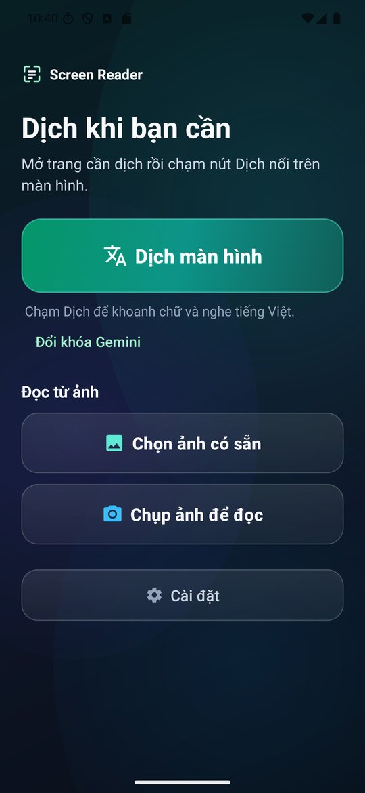
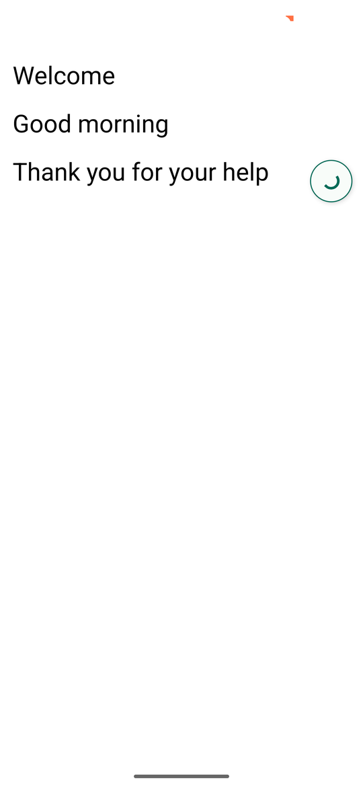
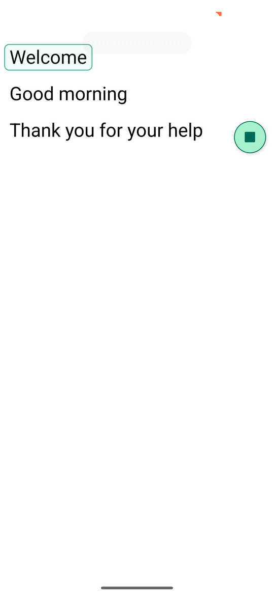

# Screen Reader

Screen Reader is an Android app that translates on-screen text into Vietnamese and reads it aloud. Tap the floating button, then drag around the text you want to hear.

## Why I built Screen Reader

I built Screen Reader for my mom. She doesn't know how to read, and I wanted her to be able to use her phone more independently. With one tap, she can hear what's on the screen in Vietnamese.

## Screenshots

| Home screen | Waiting for a translation | Reading aloud |
| :---: | :---: | :---: |
|  |  |  |

## Quick start

1. Open Screen Reader and tap **Translate screen** (**Dịch màn hình**) on the home screen.
2. On first use, paste your Gemini API key into the **Gemini API key** dialog and tap **Save**. Put the key in the app after installing it. Never add a key to the source code, Gradle configuration, or APK.
3. Allow the floating button to appear over other apps and approve Android's screen-sharing request. Select **Entire screen** if Android asks what to share.
4. Open the page you want to translate. Tap the round Screen Reader icon, drag a rectangle around the text, and release to start. Drag the button itself to reposition it.
5. A spinner shows when Screen Reader is waiting. During playback, the recognized text in the selected area gets a mint outline. Tap the spinner or stop icon to cancel the current reading.
6. To remove the floating button and end screen sharing, tap **Disable Translate button** in the Screen Reader notification or open **Settings → Screen translation settings** in the app.

To add or replace your key manually, tap **Enter Gemini key** (**Nhập khóa Gemini**) or **Change Gemini key** (**Đổi khóa Gemini**) just below **Translate screen** on the home screen. Screen translation needs an internet connection and a Gemini API key with access to the Live model configured in this build. Requests use the configured key's quota and billing.

## Read text from an image

Choose an existing image, share one to Screen Reader from another app, or take a photo. You can select, copy, share, translate, or read the recognized text aloud. This image workflow uses Android text-to-speech for playback. For Vietnamese pronunciation, select or install a Vietnamese voice in Android's text-to-speech settings.

Image recognition runs on the device. The default image translation engine uses ML Kit and works offline once the necessary language packs are downloaded. If you choose a cloud translation engine in Settings, it receives the text you ask it to translate.

## Screen translation and privacy

- Each selection captures one frame and recognizes text only inside the selected area with PP-OCRv5 Mobile Latin. ML Kit Latin is the fallback.
- Screen Reader sends the selected area's recognized text to Gemini Live in one request and plays the returned Vietnamese audio using the Zephyr voice. The screenshots themselves stay in memory on the device.
- The screen-sharing session stays active while the floating button is enabled. Capture, recognition, and Gemini requests start on demand. The screen translation flow does not use the microphone.
- Screen Reader encrypts the Gemini API key with Android Keystore and stores it in private app storage excluded from backups. Supply your own key on each installation and keep it out of the repository.
- Android can block screen capture or hide overlays on protected screens. Recognition quality depends on the text size, contrast, and script. If a screen contains more than 8,000 recognized characters, open a smaller section and try again.

## Build and install

The project uses Kotlin, Android SDK 36, JDK 17, and the included Gradle wrapper. The minimum Android version declared by the app is Android 8.0 (API 26). The floating translation flow has been exercised on an Android 15 emulator.

Open the project folder in Android Studio and run the **app** configuration, or build debug APKs from the repository root.

**Windows**

```powershell
.\gradlew.bat :app:assembleDebug
```

**macOS and Linux**

```sh
./gradlew :app:assembleDebug
```

Gradle places the APKs in `app/build/outputs/apk/debug/`. Use the file that matches your device.

| Device architecture | APK |
|---|---|
| ARM64 Android device | `app-arm64-v8a-debug.apk` |
| 32-bit ARM Android device | `app-armeabi-v7a-debug.apk` |
| x86_64 Android emulator | `app-x86_64-debug.apk` |
| x86 Android emulator | `app-x86-debug.apk` |

For example, install the ARM64 APK on a connected device with ADB.

```sh
adb install -r app/build/outputs/apk/debug/app-arm64-v8a-debug.apk
```

Debug builds use the application ID `com.arslan.textgrab.personal`.

## Credits and license

This project is based on [AhmetCanArslan/TextGrab](https://github.com/AhmetCanArslan/TextGrab), a fork of [notune/TextGrab](https://github.com/notune/TextGrab).

The app source is available under the [MIT License](LICENSE). The bundled PaddleOCR Android SDK and PP-OCRv5 Mobile Latin model are distributed under the [Apache 2.0 License](ppocr-sdk/LICENSE).
